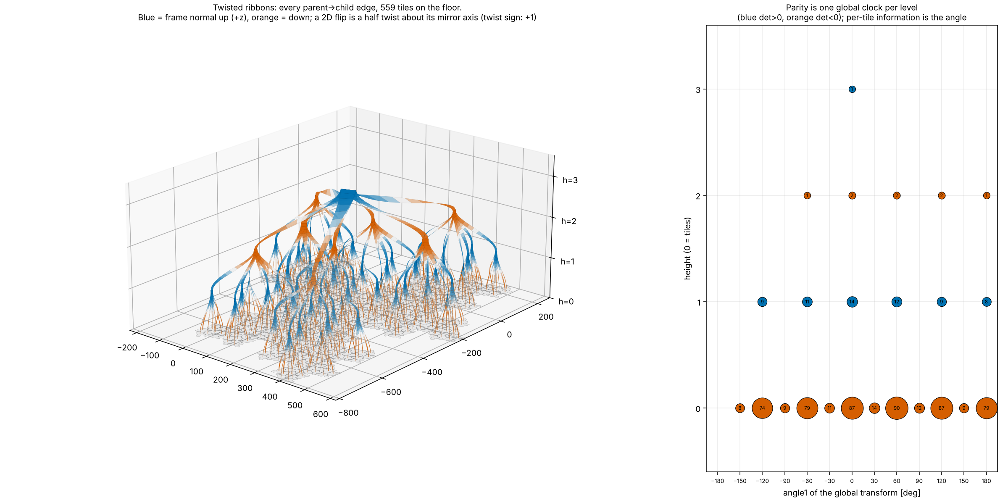
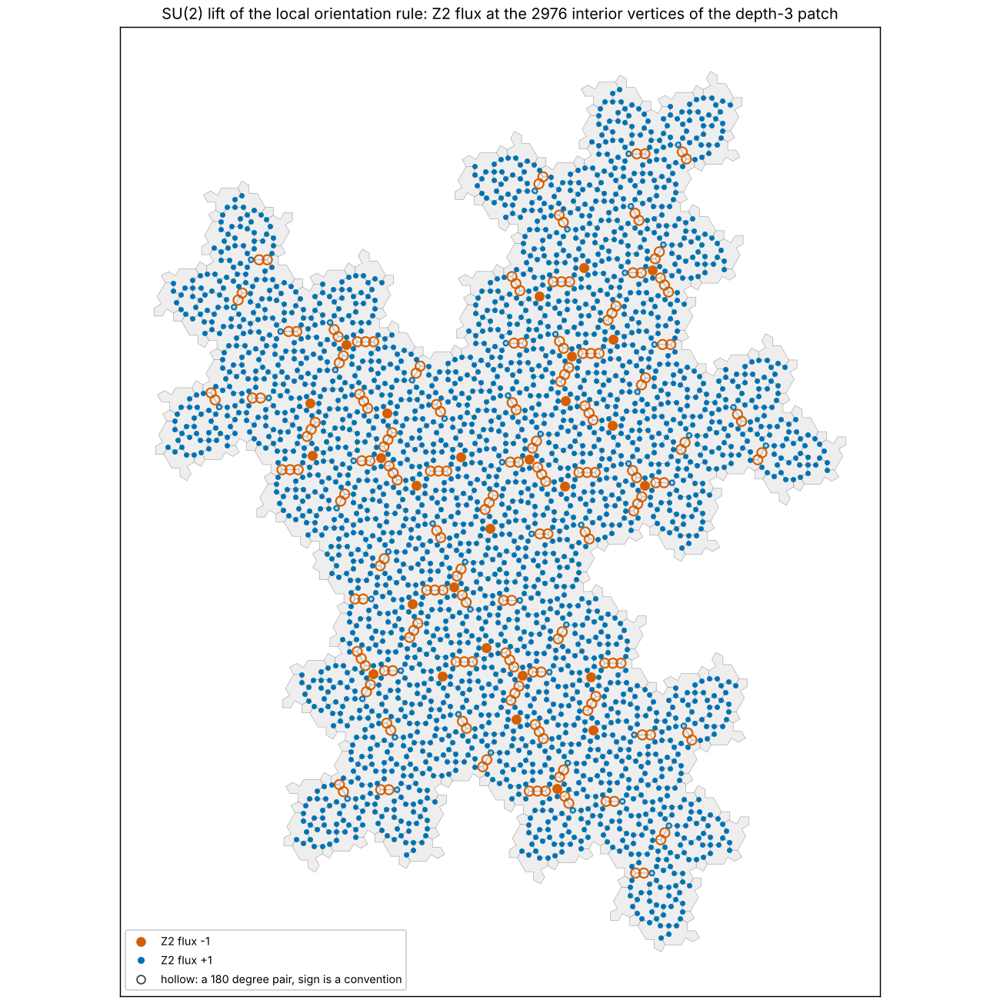

# spectrespace.py

Where the flips come from. The mirror is applied to every slot of every supertile, not only Gamma. The run shows 567 parent-to-child placements with determinant -1 and 126 with +1; all 126 of the +1 ones are the Gamma1/Gamma2 pairs. So the flip is uniform: a tile’s handedness at level n is the same for every tile, and the parity is one global clock per level. What Gamma does carry is the only non-mirror twist, Gamma2’s 30° rotation with the a and b edges swapped. The 30° angles appear only among the leaf tiles, and the per-tile information is that rotation angle, not the flip.

Making the flip smooth. A reflection can’t be reached continuously from the identity in the plane, but it can in 3D. The map L → diag(L, det L) sends the 2D transforms into 3D rotations. Under it, a planar reflection across a line becomes a half turn about that same line. So each flip becomes a half twist about its mirror axis, and a root-to-leaf chain becomes a ribbon that twists at every level. The figure shows these ribbons for every parent-to-child edge, coloured by whether the ribbon’s normal points up or down, with the tiling on the floor.

## What’s still open.

Twist direction: whether each half twist is +π or -π is not fixed by the 2D data, so it is a free choice per flip. --twist-sign sets it to +1, -1, or alternating with level; alternating is where an arrow of time could enter.
Ribbon appearance: the width direction (--ribbon-angle) and the height-per-level scale are rendering choices, not properties of the tiling.
Sealed surface: every node stores its four corner points, which could serve as a patch for the NURBS stage.

---
# spectre_holonomy.py

## 1. The derived normal holds. 
Any orientation-preserving extension of a placement to 3D that keeps the plane fixed is blockdiag(L, ε), and orientation preservation forces ε = det L. So n = det(L)·ẑ with no choice left, and n_z is constant on each level (+1, -1, +1, -1 from the root down at depth 3). One consequence for the paper: the two normals n± are tiles of opposite level parity, equivalently a patch and its mirror image, not two faces of one patch.

## 2. The connections

Finite group: the edge quaternions generate a group of order 48. Its element orders (26 of order 4, 8 of order 24) match the binary dihedral group, and the group is the same for any twist sign.
Twist sign is gauge: changing the twist sign only multiplies node holonomies by ±1. Earlier that the sign was the nontrivial Z2 datum. For the holonomies it is not.
Where the Z2 data actually lives: in a local rule that needs only the relative orientation of two touching tiles. Going once round a vertex, the SU(2) holonomy is (-1)^w, where w is the winding number of the orientation field.
Convention-dependent vortices: at depth 3, 220 of 2976 interior vertices have flux -1. Most of these (192) involve a 180° relative rotation, whose sign is a convention. The map shows them as short hollow chains.
Convention-independent vortices: 28 at depth 3 and 372 at depth 4. All are valence-3 vertices where three tiles meet with orientations 120° apart, mostly Pi/Psi/Phi triples. None touch a Mystic tile, though about 30% of all vertices do. So the flux does not localise on the Mystic, and the Mystic carries only the separate 30° rotation.
